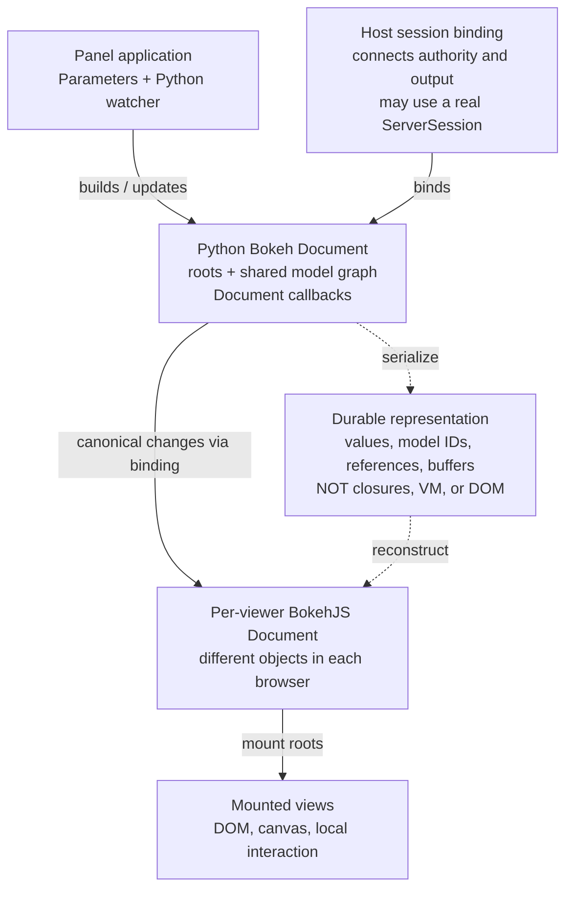
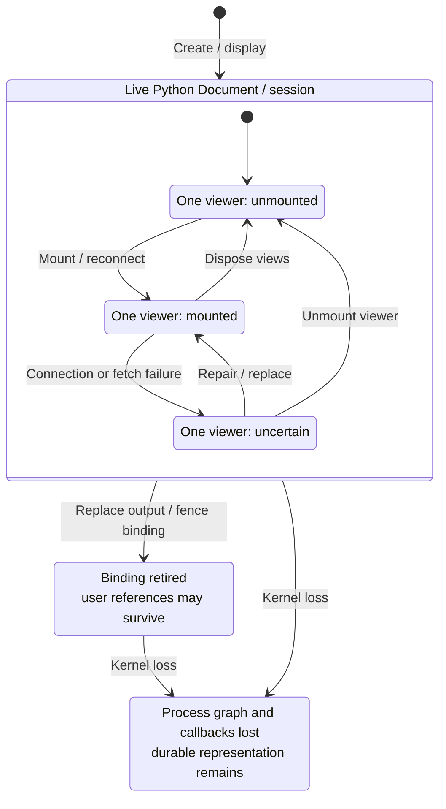
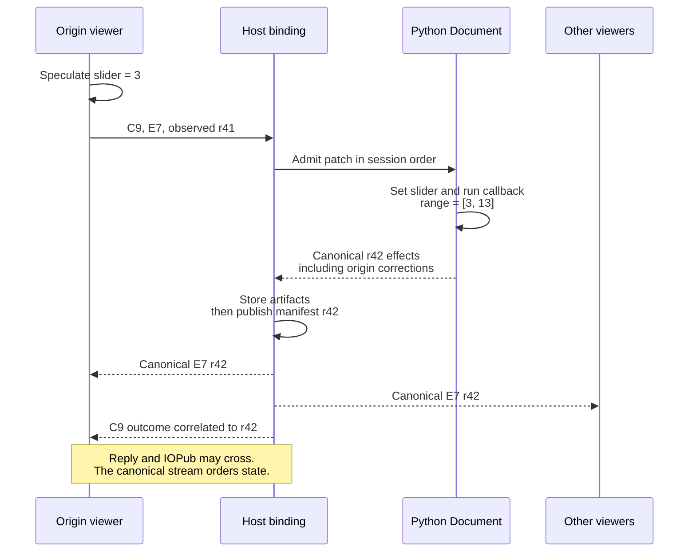
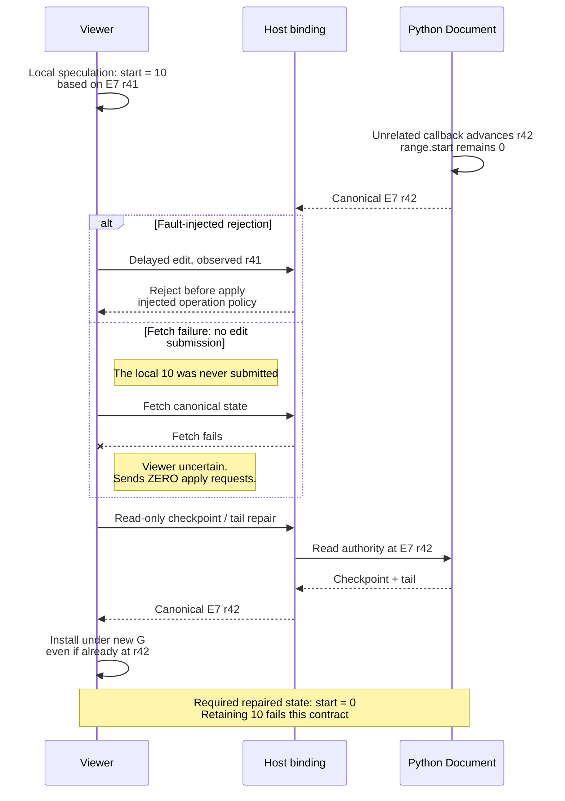
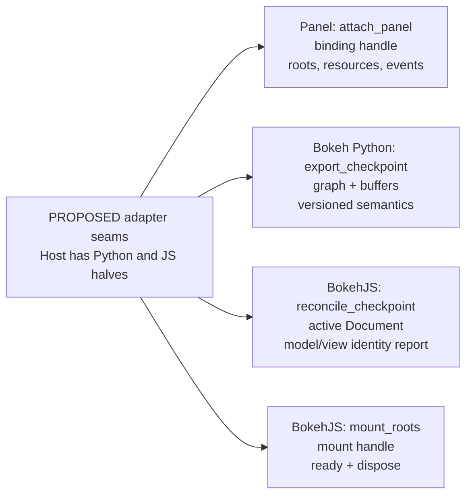

# Hosting Bokeh Documents in a notebook

**Status: draft research for docs-only PR4444, not an accepted design.** The discussion with Philipp should start with the object we are hosting: a live Bokeh Document, several browser materializations, and a durable representation—not one object spanning Python and JavaScript.



*Figure 1. Existing object kinds; host guarantees below are proposals. Dashed edges show serialization/reconstruction, not publication order (Figure 3). Multiple roots can share models: this is a graph, not a component tree.*

A **Document** groups roots and their reachable model graph, with change events and Document callback machinery. Panel Parameters and application watchers also live in Python; they are not all owned by, or serialized with, the Document. Python and BokehJS Documents are distinct objects, even when their models share serialized IDs. A **view** renders a model; its DOM lifetime need not equal the model’s lifetime. A **session binding** connects a live authority to transport, scheduling, and notebook output ownership. It is not the Document. Bokeh’s real `ServerSession` is one possible implementation component.

The [Document implementation](https://github.com/bokeh/bokeh/blob/1605765de30309a46a17ea1874abb437a695f65f/src/bokeh/document/document.py) supplies useful operations, but that does not make every method a stable embedding API. Serialization preserves a declared rendering state, not arbitrary Python execution.

## A small application worth following end to end

```python
import panel as pn
from bokeh.models import Range1d
from bokeh.plotting import figure
from IPython.display import display

pn.extension()
slider = pn.widgets.FloatSlider(
    name="Window start", start=0, end=20, value=0, step=1
)
plot = figure(x_range=Range1d(start=0, end=10), height=250)
plot.line([0, 5, 10, 15, 20, 25], [0, 1, 0, 1, 0, 1])

def move_window(event):
    plot.x_range.start = event.new
    plot.x_range.end = event.new + 10

slider.param.watch(move_window, "value")
app = pn.Column(slider, plot)
display(app)
```

This is ordinary, existing Panel/Bokeh usage—not a proposed adapter API. Displaying it through nteract’s [current Panel producer](https://github.com/nteract/nteract/blob/02a06ceebb7b73221369005da69e019b0aee1d6a/python/nteract-kernel-launcher/nteract_kernel_launcher/_panel.py) constructs a Document/root graph and connects Panel’s machinery. The Python application retains a real watcher, not a serialized description of one.

Moving the slider to `3` should invoke `move_window` and produce range `[3, 13]` for every viewer. That gives us something concrete to inspect: the browser input, Python callback, resulting model changes, and mounted plot.

The later `range.start=10` rejection is a **separate fault-injected branch**. Nothing in this example ordinarily rejects that assignment.

## Which lifetime ends?



*Figure 2. Proposed lifetime guarantees. Each viewer has its own nested state; only one is drawn. Kernel loss exits the outer state from any viewer substate. Disconnection alone is not proof of kernel loss.*

Unmounting disposes that viewer’s browser views and subscriptions. It does **not** close the shared Python Document/session. Reconnection materializes the existing Python authority without registering application callbacks again.

Output replacement first fences the old binding, then releases host-owned registrations, tasks, and resources. It cannot promise to destroy Python objects still referenced by user code. Kernel loss, by contrast, destroys the live process graph and callbacks; only already-published durable state can remain. Artifact survival is subject to retention, not an indefinite promise.

A disconnected viewer is uncertain, not evidence that Python died. If Python is gone, the saved rendering must identify unavailable Python interaction rather than queue controls for later replay.

## Follow one accepted change



*Figure 3. Proposed revisioned outcome and publication behavior—not an existing Bokeh protocol guarantee.*

`E7` identifies an authority incarnation; `r41` and `r42` order its canonical transitions. `C9` identifies a command. Viewer install generation `G` fences asynchronous browser work. Model IDs identify graph objects. These identifiers are not interchangeable.

The origin must receive canonical effects too: suppressing every “echo” could suppress a Python correction. Callback-driven changes belong in the captured result, not merely the browser’s submitted property patch. Application failure after partial mutation requires reporting surviving state or explicit session failure—not a fictitious rollback.

Later asynchronous callbacks produce later revisions. Batching notifications with Bokeh’s [callback/hold machinery](https://github.com/bokeh/bokeh/blob/1605765de30309a46a17ea1874abb437a695f65f/src/bokeh/document/callbacks.py) does not establish transactional rollback or atomic observation across Python, browsers, and storage.

## Repair authority, not just connectivity



*Figure 4. Two independent recovery triggers. Neither permits replaying browser controls as a repair mechanism.*

The [shipped admission code](https://github.com/nteract/nteract/blob/02a06ceebb7b73221369005da69e019b0aee1d6a/python/nteract-kernel-launcher/nteract_kernel_launcher/_bokeh_session.py#L232-L241) broadly accepts `base <= head` under last-writer-wins behavior. A delayed edit is therefore **not automatically rejected**. A proposed operation-specific policy might reject before application; this diagram deliberately injects that outcome.

Repair must establish reconstruction equivalence. Python [serialization can omit defaults](https://github.com/bokeh/bokeh/blob/1605765de30309a46a17ea1874abb437a695f65f/src/bokeh/core/has_props.py), while BokehJS [same-ID deserialization](https://github.com/bokeh/bokeh/blob/1605765de30309a46a17ea1874abb437a695f65f/bokehjs/src/lib/core/serialization/deserializer.ts) updates supplied attributes. Consequently, sparse merging can leave browser `10` where authoritative reconstruction yields `0`. Defaults, themes, and custom models make “reset missing properties” insufficient without defined semantics.

Install authoritative state even at the same revision under a new `G`; stale fetches and late mounts must not win afterward. Use controlled replacement when equivalent reconciliation cannot be established. Preserve model identity only where correctness permits, and report view continuity separately.

Default repair discards unsent edits. An optional draft belongs outside the canonical graph and needs explicit resubmission—not automatic control replay. A checkpoint leaves `E7` unchanged; a replacement authority `E8` fences all `E7` work.

## Which upstream hosting boundary?

| Candidate | What upstream owns | What needs a supported seam |
|---|---|---|
| **A: host a Document directly** | Model graph and change semantics | Panel scheduling/context, connection and cleanup binding |
| **B: host a real ServerSession in-kernel** | Model graph plus server-session scheduling/context | Embedding/transport boundary and notebook lifetime binding |

A thin host needs supported Panel integration; it does not acquire locking, scheduling, or lifecycle guarantees simply by owning a Document. A real [Bokeh `ServerSession`](https://github.com/bokeh/bokeh/blob/1605765de30309a46a17ea1874abb437a695f65f/src/bokeh/server/session.py) supplies server-session machinery, but does not by itself solve notebook durability or revision-correlated acceptance.

Panel’s [PanelExecutor implementation](https://github.com/holoviz/panel/blob/95c0be7b4e57aea92dc9df556d79f3be46fc6f49/panel/io/jupyter_executor.py) is concrete precedent for in-kernel server-session hosting and comm transport—not a promised public embedding API. [Panel scheduling](https://github.com/holoviz/panel/blob/95c0be7b4e57aea92dc9df556d79f3be46fc6f49/panel/reactive.py) makes context compatibility a practical concern.

The first design experiment should try B’s existing session context. Choose **B** if representative applications work with fewer enduring private hooks. Compare ordinary watchers, asynchronous callbacks, session-dependent applications, and custom extensions. There is no reason to ratify A merely because an adapter already exists.

## Four concrete API asks

All names in the sketches are **ILLUSTRATIVE PROPOSALS for a host adapter**, not existing Bokeh or Panel functions.



*Figure 5. Four independent proposed seams, their suggested upstream owners, and returned values. This is an API map, not call order or a wire protocol. Disposal is invoked later through the returned handles.*

| Ask | Suggested upstream owner | Existing capability | Missing supported boundary |
|---|---|---|---|
| Authoritative export | Bokeh Python | [Document.to_json](https://github.com/bokeh/bokeh/blob/1605765de30309a46a17ea1874abb437a695f65f/src/bokeh/document/document.py), with [settings-dependent property serialization](https://github.com/bokeh/bokeh/blob/1605765de30309a46a17ea1874abb437a695f65f/src/bokeh/core/has_props.py) | Per-call, versioned reconstruction semantics |
| Browser repair | BokehJS | Deserialization and graph replacement | Supported prepare/reconcile with explicit fallback |
| Root mounting | BokehJS | Existing embedding and view machinery | Async-ready, disposal-safe root handle |
| Panel attachment | Panel; Bokeh for session hosting | `get_root(doc, comm=None)`, private adapter lifecycle, PanelExecutor | Supported binding or ServerSession-backed hosting |

### 1. Export a reconstructible checkpoint

```text
adapter.export_checkpoint(
    document, reconstruction_version, serialization_options
) -> checkpoint + buffers + resource_descriptors
```

The export must define authoritative omission semantics per call/version, including defaults, themes, custom-model definitions, references, and buffers. The host captures it within the chosen Document/session mutation boundary and stamps the corresponding revision; serialization alone does not establish that ordering. It must state which resources are enumerated and which remain application responsibilities. Unknown: can existing serialization provide this contract without a new format? Exporting bytes alone cannot certify portable resource closure.

### 2. Reconcile—or explicitly replace

```text
await adapter.reconcile_checkpoint(
    js_document, checkpoint, mode="equivalent-or-replace"
) -> document + retained_models + replaced_models + view_continuity
```

Preparation should validate versions, definitions, buffers, and references before installation. Compatible retained/replaced models must be reported separately from mounted-view continuity. Unsupported reconciliation falls back to controlled replacement. This asks for neither rollback nor atomic observer guarantees. The [view manager](https://github.com/bokeh/bokeh/blob/1605765de30309a46a17ea1874abb437a695f65f/bokehjs/src/lib/core/view_manager.ts) reinforces why model and view lifetimes require separate answers.

### 3. Own a root mount’s asynchronous lifetime

```text
mount = adapter.mount_roots(js_document, targets, generation=G)
await mount.ready
await mount.dispose()
```

`dispose()` must cover subscriptions, resources, and views created after unmount began; completion must mean those mount-owned resources are released. It must not destroy the shared graph implicitly. Unknowns include cancellation boundaries and which existing embedding operations can support this handle without private view traversal.

### 4. Attach Panel through a supported binding

```text
binding = adapter.attach_panel(
    app, document, transport, scheduler, context, output, on_error
)
await binding.dispose()
```

Inbound transport commands should enter the chosen scheduling/session context; outbound Document events should capture callback-induced changes for host publication. The binding must define which watchers, callbacks, tasks, connection hooks, and resources it owns and releases at disposal. It must not claim ownership of every application watcher or Python reference. It must also route output and errors to the bound notebook output, including background work.

Panel’s [document lifecycle utilities](https://github.com/holoviz/panel/blob/95c0be7b4e57aea92dc9df556d79f3be46fc6f49/panel/io/document.py) are evidence, not a complete host contract. Prefer one upstream binding object or supported ServerSession transport integration if that avoids parallel lifecycle machinery.

## Questions for Philipp and upstream

1. Can checkpoint export define per-call, versioned omission semantics covering themes, custom defaults/models, buffers, and required resources?
2. Where should supported BokehJS reconciliation live, and which model-identity and mounted-view guarantees can it report before choosing replacement?
3. Can root mounting expose async readiness and disposal that also catches late-created views without destroying the Document?
4. Which representative Panel applications require real ServerSession context, and should the supported host boundary reuse that object?
5. Could one binding own inbound transport scheduling, outbound callback-event capture, output/error routing, resource enumeration, and cleanup—or which responsibilities must remain with the host?

## Appendix: notebook integration and acceptance evidence

Research pins: Bokeh 3.9.2, Panel 1.9.4, Automerge 0.11.0, and nteract snapshot `02a06cee`; links below and above pin exact source commits.

Existing nteract runtime manifests and artifact references describe published session state; [RxJS projections](https://github.com/nteract/nteract/blob/02a06ceebb7b73221369005da69e019b0aee1d6a/packages/runtimed/src/observable-store.ts) expose it to viewers. [Automerge](https://github.com/automerge/automerge/blob/8feb8be8be203e3b878bf2cb5919601094f3c816/rust/automerge/src/lib.rs) replicates descriptors and references, not live Bokeh graphs or callback execution. Python producer hooks remain useful: propose execution-bound artifact/checkpoint publication through typed envelopes and raw binary, building on the [binary-output hook](https://github.com/nteract/nteract/blob/02a06ceebb7b73221369005da69e019b0aee1d6a/python/nteract-kernel-launcher/nteract_kernel_launcher/_buffer_hook.py). Optional scoped CommsDoc operations suit state whose merge and delivery semantics fit. A new document or sidecar is warranted only by distinct writers, subscriptions, or retention requirements. Publication must make required artifacts available before advertising their manifest.

Host admission must enforce permissions, incarnation/output fences, and bounded publication. Deduplication needs a pending command record before mutation, then a recorded outcome; conflicting command-ID reuse must fail. A lost pending outcome remains unknown, not permission to rerun callbacks. Callback side effects are not exactly-once across crashes. Applied state, durable publication, and viewer installation are separate milestones.

Supplied regressions compare [PR4437 exact head `3e94af17`](https://github.com/nteract/nteract/blob/3e94af17f2ea0292440ed0d2f934a873a46a0064/src/isolated-renderer/bokeh-session-controller.ts) with [stable `d552f512`](https://github.com/nteract/nteract/blob/d552f512676a9edb718db72f5a4914ab308e47d0/src/isolated-renderer/bokeh-session-controller.ts):

| Supplied fault | Head observation | Stable / future acceptance oracle |
|---|---|---|
| Rejected edit + sparse checkpoint | Browser `start=10`, Python `0` | Restore browser `0` |
| Failed fetch + explicit checkpoint | Browser retains `10`; **ZERO apply requests** | Restore browser `0`, still zero applies |

The supplied evidence used real Bokeh, mounted Panel, and a live isolated kernel. This research ran no new runtime tests; whole native-notebook acceptance was not tested at that head. These motivate API contract tests, not an architecture gate on bounded PR corrections. Additional oracles should inspect disposal and late mounts, reconnect without duplicate callbacks, custom defaults/themes, later asynchronous revisions, and complete resource cleanup/reconstruction.
